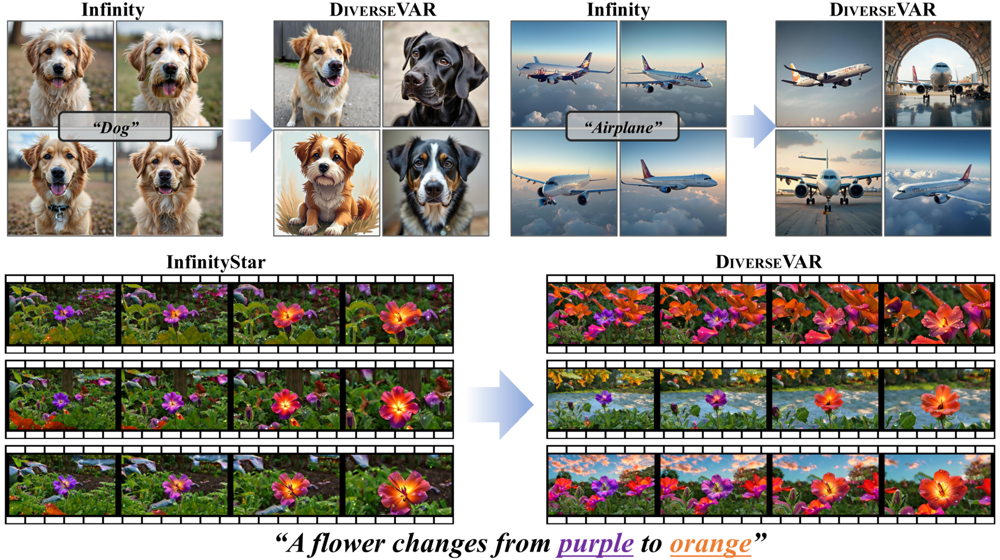

<div align="center">
<h2>DiverseVAR: Balancing Diversity and Quality of Next-Scale Visual Autoregressive Models</h2>

[Mingue Park*](https://uygnim99.github.io/) · [Prin Phunyaphibarn*](https://prinphunya.github.io/) · [Phillip Y. Lee](https://phillipinseoul.github.io/) · [Minhyuk Sung](https://mhsung.github.io/)

(* Equal Contribution)

KAIST

<span style="font-size: 1.5em;"><b>ECCV 2026</b></span>

<a href="https://arxiv.org/abs/2511.21415"></a>
<a href='https://diverse-var.github.io'></a>



## TL;DR

***DiverseVAR** is a training-free inference framework for text-conditioned visual autoregressive models. It injects annealed noise into the text embedding (condition annealing) to break the near-deterministic behavior of VAR sampling, then repairs the resulting artifacts with **scale-travel**, a latent refinement step that rewinds intermediate features to a coarser scale via the multi-scale encoder and resumes generation. The result advances the diversity–quality Pareto front on both image and video generation, with no retraining and negligible overhead.*


</div>

## Integrations


| Integration                      | Modality      | Base model                                                           | Entry point                              | Evaluation                         |
| -------------------------------- | ------------- | -------------------------------------------------------------------- | ---------------------------------------- | ---------------------------------- |
| [`infinity/`](infinity/)         | text-to-image | [Infinity](https://github.com/FoundationVision/Infinity)             | `infinity/inference.py`                  | LPIPS-MPD, Vendi, ImageReward, FID |
| [`switti/`](switti/)             | text-to-image | [Switti](https://github.com/yandex-research/switti)                  | `switti/inference.py`                    | LPIPS-MPD, Vendi, ImageReward, FID |
| [`infinitystar/`](infinitystar/) | text-to-video | [InfinityStar](https://huggingface.co/FoundationVision/InfinityStar) | `infinitystar/tools/infer_video_480p.py` | VBench / VBench-2.0                |


Each integration is self-contained: its own Conda environment, requirements, checkpoints, and README.

## Environment and Requirements


### Tested Environment

- **Python:** 3.10 (Infinity, InfinityStar) / 3.11 (Switti)
- **PyTorch:** 2.5.1 (Infinity, InfinityStar) / 2.4.1 (Switti)
- **CUDA:** 12.4
- **GPU:** Tested on NVIDIA RTX A6000 (48 GB). The 8B checkpoints do not fit on a 24 GB GPU without offloading.


### Installation

In the commands below, `<MODEL>` is one of: `infinity`, `switti`, `infinitystar`.

```bash
cd <MODEL>
conda env create -f environment.yml
conda activate diversevar-<MODEL>
pip install -r requirements.txt

# Infinity and InfinityStar only
pip install flash-attn==2.7.4.post1 --no-build-isolation
```


# Checkpoint Download

No checkpoint, dataset, or generated result is bundled in this repository. Download the weights for
the integration you want to run and pass every path explicitly.

### Infinity

Download from [FoundationVision/Infinity](https://huggingface.co/FoundationVision/Infinity). For the
2B model, place `infinity_2b_reg.pth` and `infinity_vae_d32reg.pth` under `infinity/weights/`. The
T5 encoder defaults to `google/flan-t5-xl` and is fetched by Transformers on first use.

### Switti

`yresearch/Switti-1024` and its VQ-VAE dependencies are downloaded automatically from Hugging Face on
first use. If the repository becomes gated, authenticate with `huggingface-cli login`; never place a
token in source code.

### InfinityStar

```bash
huggingface-cli download FoundationVision/InfinityStar \
  --local-dir infinitystar/pretrained/InfinityStar
```

The expected directory contains `infinitystar_8b_480p_weights/`, `infinitystar_videovae.pth`, and
`text_encoder/flan-t5-xl-official/`.

# Method Controls


DiverseVAR is configured entirely through inference flags, shared by all three integrations.


| Stage               | Flag              | Meaning                                                                                                                                                                                                              |
| ------------------- | ----------------- | -------------------------------------------------------------------------------------------------------------------------------------------------------------------------------------------------------------------- |
| Condition annealing | `--noise_type`    | Where noise is injected. Text embedding (**the paper's choice**): `cads` for Infinity / InfinityStar, `context` for Switti. `<SOS>` token: `sos` (Infinity, InfinityStar) or `cond_bd` (Switti). `none` disables it. |
| Condition annealing | `--noise_scale`   | Initial noise magnitude $\alpha(1)$                                                                                                                                                                                  |
| Condition annealing | `--noise_stage`   | Number of leading scales that receive noise ($k_{\max}$)                                                                                                                                                             |
| Condition annealing | `--anneal_func`   | Annealing schedule $\alpha(\cdot)$; the paper uses `cosine`                                                                                                                                                          |
| Scale-travel        | `--repeat_num`    | Number of scale-travel passes (`1` disables it)                                                                                                                                                                      |
| Scale-travel        | `--encode_stage`  | Scale $l$ whose feature map is re-encoded                                                                                                                                                                            |
| Scale-travel        | `--restart_stage` | Coarser scale $m < l$ from which generation resumes                                                                                                                                                                  |


To reproduce the **baseline** model instead, set `--noise_type none --noise_scale 0 --repeat_num 1`.

# Inference


All three integrations read prompts from a text file, one prompt per line. The shared
[`prompts/`](prompts) directory holds the lists used in this work:

| File | Prompts | Description |
|---|---|---|
| `prompts/ms-coco-1000-prompts.txt` | 1000 | Captions sampled from the MS-COCO val2014 30K caption set used for FID |
| `prompts/mjhq-mixed-1000-prompts.txt` | 1000 | Prompts sampled from MJHQ-30K, mixed across its category splits |

Paths below are written relative to the integration directory you `cd` into, so the shared lists are
reached as `../prompts/<file>`.

> **Note.** Benchmark lists must keep the `<dataset>-<variant>-<count>-prompts.txt` shape. The
> in-process evaluator (`inference.py --eval 1`) reads the prompt count from the third
> `-`-separated field of the path, and its FID branch picks the reference set from the first field
> of the filename (`ms` → MS-COCO, `mjhq` → MJHQ-30K; anything else skips FID). The two
> `example-*-prompt.txt` files intentionally do not follow that shape — they are for qualitative
> runs, so do not pass them with `--eval 1`. The standalone `evaluate.py` does not depend on the
> filename at all; it takes `--fid_dataset` explicitly.

### Infinity

```bash
cd infinity
python inference.py \
  --network_type infinity_2b \
  --model_path weights/infinity_2b_reg.pth \
  --vae_path weights/infinity_vae_d32reg.pth \
  --prompt_txt ../prompts/example-image-prompt.txt \
  --save_path outputs/infinity \
  --imgs_per_prompt 4 --save_indv 1 \
  --noise_type cads --noise_scale 1.0 --noise_stage 4 \
  --anneal_func cosine --noise_rescale 1.0 \
  --repeat_num 2 --encode_stage 8 --restart_stage 2
```


### Switti

```bash
cd switti
python inference.py \
  --model_path yresearch/Switti-1024 \
  --prompt_txt ../prompts/example-image-prompt.txt \
  --save_path outputs/switti \
  --imgs_per_prompt 4 --save_indv 1 \
  --noise_type context --noise_scale 1.0 --noise_stage 6 \
  --anneal_func cosine --noise_rescale 1.0 \
  --repeat_num 2 --encode_stage 8 --restart_stage 3
```


### InfinityStar

DiverseVAR is applied to the keyframe stage only, as described in the paper. Leave
`--noise_stage_video 0 --repeat_num_video 1` unless you are explicitly studying temporal-stage
variants. Line 1 of the example list is the motion-aware augmented prompt denoted by † in Fig. 7.

```bash
cd infinitystar
python tools/infer_video_480p.py \
  --checkpoints_dir pretrained/InfinityStar \
  --prompt_txt ../prompts/example-video-prompt.txt \
  --save_dir outputs/infinitystar --duration 5 --num_seeds 3 \
  --noise_type cads --noise_seed 990730 \
  --noise_scale 1.0 --noise_stage 8 \
  --anneal_func cosine \
  --repeat_num 2 --encode_stage 12 --restart_stage 6
```

Outputs are written to a nested directory that records every sampling setting, together with a
`metadata.json` describing the run.

> **Note.** These commands are compact qualitative runs, not scripts that reproduce every paper
> table. Exact scores depend on checkpoints, prompts, seeds, optional prompt rewriting, metric
> versions, and GPU kernels.


# Evaluation


Evaluation backends carry additional dependencies and checkpoints; install only the metrics you
need. Nothing here is bundled: no metric checkpoint, no FID reference statistics.

### Metrics

| Metric | Role | Backend | What it computes |
|---|---|---|---|
| **LPIPS-MPD** | diversity | [`lpips`](https://github.com/richzhang/PerceptualSimilarity) (`net='alex'`) | Mean pairwise LPIPS distance between all image pairs **within one prompt**, averaged over prompts. Higher = more diverse. Reported as `LPIPS_Mean` / `LPIPS_Std`. |
| **Vendi** | diversity | [`vendi-score`](https://github.com/vertaix/Vendi-Score) + [SSCD](https://github.com/facebookresearch/sscd-copy-detection) | Per-prompt effective number of dissimilar samples: SSCD embeddings → cosine-similarity matrix → `vendi.score_K`, averaged over prompts. Following CADS, SSCD is the similarity backbone. Also reports `Vendi_MSS`, the mean pairwise cosine similarity. |
| **ImageReward** | quality | [`image-reward`](https://github.com/THUDM/ImageReward) | Human-preference reward per (prompt, image) pair, averaged over all images. Higher = better perceived quality and alignment. |
| **FID** | quality + diversity | see below | Fréchet distance to a benchmark reference set. |
| **VBench** | video quality | [VBench](https://github.com/Vchitect/VBench) | Frame-wise and temporal Quality Score for generated videos, computed by the official evaluator. |
| **VBench-2.0** | video diversity | [VBench-2.0](https://github.com/Vchitect/VBench/tree/master/VBench-2.0) | Inter-sample style and content variation (VGG-19 based) for videos generated from the same prompt. |

SSCD-based metrics require `DIVERSEVAR_SSCD_PATH` to point to an SSCD TorchScript checkpoint
(e.g. `sscd_disc_mixup.torchscript.pt` from the [SSCD release](https://github.com/facebookresearch/sscd-copy-detection#model-zoo)):

```bash
export DIVERSEVAR_SSCD_PATH=/path/to/sscd_disc_mixup.torchscript.pt
```

### Image Naming Convention (required for per-prompt diversity)

LPIPS-MPD and Vendi are **per-prompt** metrics: they sort the image files in a folder
lexicographically and slice that list into consecutive chunks of `imgs_per_prompt`, treating each
chunk as the sample set of one prompt. The generated filenames must therefore sort so that all
images of a prompt are contiguous and prompt order is preserved:

```
<save_path>/
  00000_00.png   # prompt 0, sample 0
  00000_01.png   # prompt 0, sample 1
  ...
  00000_09.png
  00001_00.png   # prompt 1, sample 0
  ...
  metadata.json
```

i.e. `{prompt_idx:05d}_{sample_idx:02d}.{ext}` — exactly what `inference.py --save_indv 1` writes,
with the same keys mirrored in `metadata.json` under `images`. Keep the zero padding: `10_0.png`
would sort before `2_0.png` and silently mix prompts. `evaluate.py` recovers
`(prompt_num, imgs_per_prompt)` from those metadata keys and fails loudly if the count differs
across prompts, so every prompt must have the same number of samples. Flat folders only — one
directory per configuration, no nesting. Prompt text is read from `metadata.json`, so quality and
alignment metrics require it to sit next to the images.

In the paper we use 100 prompts × 10 images for the Pareto fronts (Fig. 6) and 1000 prompts ×
10 images for Tab. 1.

### FID

FID uses a different backend per benchmark, selected by `--fid_dataset` (or auto-detected from the
save path):

| Benchmark | Package | Reference set | Notes |
|---|---|---|---|
| MS-COCO | [`T2IBenchmark`](https://github.com/boomb0om/text2image-benchmark) (`calculate_fid` + `get_coco_fid_stats`) | Precomputed InceptionV3 statistics over the **MS-COCO val2014 30K** split (`MS-COCO_val2014_fid_stats.npz`, downloaded and cached automatically on first use) | Generated images are compared directly against those stats; nothing to prepare manually. Prompts come from the same 30K caption pool as `ms-coco-1000-prompts.txt`. |
| MJHQ-30K | [`clean-fid`](https://github.com/GaParmar/clean-fid) (`fid.compute_fid(..., mode="clean", dataset_split="custom")`) | **Custom** statistics you build once from the 30 000 reference images of [MJHQ-30K](https://huggingface.co/datasets/playgroundai/MJHQ-30K) | clean-fid resizing (`mode="clean"`) avoids the resizing artifacts of legacy FID implementations. |

Build the MJHQ-30K reference statistics once, under the exact name the evaluator looks up
(`dataset_name="mjhq-30k"`, `dataset_split="custom"`):

```python
from cleanfid import fid
# <mjhq-ref-dir> contains the 30k MJHQ-30K reference images (all categories, flat or nested)
fid.make_custom_stats("mjhq-30k", "<mjhq-ref-dir>", mode="clean")
```

FID is computed over the **whole** generation folder (all prompts × all samples), unlike the
per-prompt diversity metrics, so it captures quality and diversity jointly. Use the 1000-prompt
lists for it; a handful of prompts gives a meaningless FID.

### Running the Evaluator — Infinity and Switti

Both image integrations ship the **same** `evaluate.py` and `evaluation/eval_metrics.py` (identical
files, one copy per self-contained integration), so the command, the flags and the `scores.json`
schema are identical; only the Conda environment differs. The evaluator reads `metadata.json`,
derives `prompt_num` / `imgs_per_prompt` from it, and writes `scores.json` next to the images —
`metadata.json` is never modified.

```bash
cd infinity            # or: cd switti
python evaluate.py --save_path <generated-image-directory> \
  --metrics LPIPS,Vendi,ImageReward,FID --fid_dataset mjhq-30k
```

| Flag | Effect |
|---|---|
| `--metrics` | Comma-separated subset of `LPIPS`, `Vendi`, `ImageReward`, `FID`. |
| `--image_exts` | `auto` by default — detects `png` (Infinity) or `jpg` (Switti). |
| `--fid_dataset` | `ms-coco` or `mjhq-30k`; auto-detected from the prompt-file name in the path. |
| `--scores_path` | Write the scores elsewhere; defaults to `<save_path>/scores.json`. |
| `--label` | Optional tag stored in `scores.json` for downstream aggregation. |
| `--overwrite` | Recompute metrics already present; without it a run resumes. |

The same code path runs in-process right after generation with `inference.py --eval 1`
(`--eval_metrics` selects what is computed), so an interactive run and a post-hoc scoring pass
produce identical score files.


### Running the Evaluator — InfinityStar

VBench is intentionally not vendored. Install it separately, generate its inputs, then follow the
official VBench / VBench-2.0 evaluator instructions on the output directory.

```bash
cd infinitystar
python tools/infer_vbench2_480p.py \
  --worker_id 0 --num_workers 1 \
  --checkpoints_dir pretrained/InfinityStar \
  --vbench_prompt_dir /path/to/VBench-2.0/prompts/prompt \
  --save_dir outputs/vbench2 \
  --dimensions Diversity --max_prompts_per_dim 1 \
  --noise_type cads --noise_seed 990730 \
  --noise_scale 1.0 --noise_stage 8 \
  --anneal_func cosine --repeat_num 2 --encode_stage 12 --restart_stage 6
```


# Repository Policy

- No checkpoint, dataset, generated result, or API token is bundled.
- All paths in the commands above are user-provided or repository-relative.
- VBench and other large third-party evaluation projects are installed separately.
- The upstream license is retained in each model directory. Review all upstream model and dataset
licenses before redistribution.


# Acknowledgements & Citation

This repository is built on top of the [Infinity](https://github.com/FoundationVision/Infinity),
[Switti](https://github.com/yandex-research/switti), and
[InfinityStar](https://huggingface.co/FoundationVision/InfinityStar) codebases. Please cite the
corresponding base model alongside our work. If you find our work useful, please cite:

```
@article{park2026diversevar,
  title={DiverseVAR: Balancing Diversity and Quality of Next-Scale Visual Autoregressive Models},
  author={Park, Mingue and Phunyaphibarn, Prin and Lee, Phillip Y. and Sung, Minhyuk},
  year={2026}
}
```

